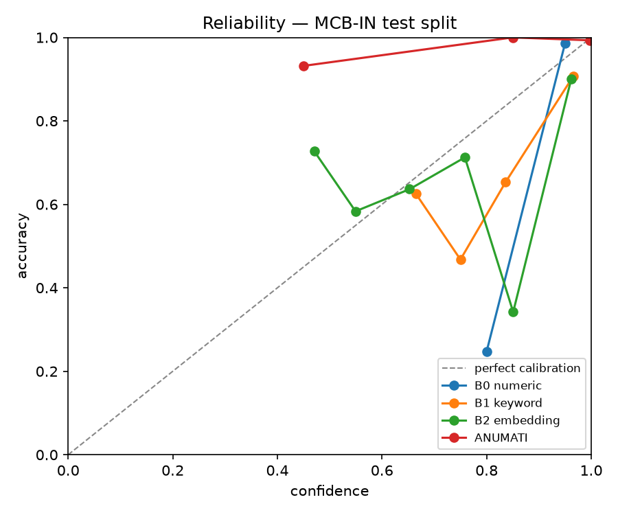

# MCB-IN results

Generated by `bench/run_eval.py` on 2026-11-25T11:02:49+00:00. Nothing else in this repository writes metric numbers.

## What the labels are

Gold labels come from how each case was **built** — the perturbation operator applied, or the structured catalogue fields — never from any model's output. The engine's own LLM path is not consulted when labelling.

## Split

Whole operators and whole categories are held out for test. Thresholds are tuned on dev and frozen before the test run.

```json
{
  "dev_cases": 1255,
  "test_cases": 647,
  "held_out_operators": [
    "dietary_violation",
    "near_colour",
    "near_pack_size",
    "recurrence_flip"
  ],
  "held_out_categories": [
    "Apparel > Men > Track Pants",
    "Apparel > Women > Kurtas",
    "Fitness > Accessories > Yoga Mats",
    "Footwear > Sports > Walking",
    "Grocery > Dairy > Paneer",
    "Grocery > Edible Oils > Mustard Oil",
    "Grocery > Edible Oils > Sunflower Oil",
    "Grocery > Staples > Sugar & Salt",
    "Personal Care > Skin Care > Moisturiser"
  ]
}
```

## dev split

| System | n | Viol. recall | False-block | Step-up | Macro-F1 | Hinglish gap | Injection ASR | p95 ms | ECE |
|---|---|---|---|---|---|---|---|---|---|
| B0 numeric | 1255 | 85.7% | 1.7% | 0.0% | 57.5% | -31.5% | 40.0% | 0.02 | 7.3% |
| B1 keyword | 1255 | 97.8% | 41.5% | 0.0% | 52.9% | 3.0% | 40.0% | 0.02 | 9.2% |
| B2 embedding | 1255 | 99.0% | 84.7% | 0.0% | 36.4% | -7.8% | 20.0% | 0.53 | 19.9% |
| ANUMATI | 1255 | 99.9% | 7.1% | 3.0% | 97.4% | 2.4% | 0.0% | 0.05 | 4.0% |

## test split

| System | n | Viol. recall | False-block | Step-up | Macro-F1 | Hinglish gap | Injection ASR | p95 ms | ECE |
|---|---|---|---|---|---|---|---|---|---|
| B0 numeric | 647 | 54.5% | 4.3% | 0.0% | 36.5% | -0.3% | 0.0% | 0.02 | 32.7% |
| B1 keyword | 647 | 91.6% | 28.7% | 0.0% | 50.0% | 17.1% | 0.0% | 0.02 | 8.8% |
| B2 embedding | 647 | 98.2% | 73.4% | 0.0% | 42.5% | 1.9% | 0.0% | 0.59 | 8.6% |
| ANUMATI | 647 | 99.4% | 4.3% | 6.8% | 97.9% | 2.0% | 0.0% | 0.08 | 4.2% |

## Confusion matrices

**B0 numeric — dev**

| gold \ predicted | CONFORMS | VIOLATES | AMBIGUOUS |
|---|---|---|---|
| **CONFORMS** | 346 | 6 | 0 |
| **VIOLATES** | 124 | 741 | 0 |
| **AMBIGUOUS** | 38 | 0 | 0 |

**B0 numeric — test**

| gold \ predicted | CONFORMS | VIOLATES | AMBIGUOUS |
|---|---|---|---|
| **CONFORMS** | 90 | 4 | 0 |
| **VIOLATES** | 233 | 279 | 0 |
| **AMBIGUOUS** | 41 | 0 | 0 |

**B1 keyword — dev**

| gold \ predicted | CONFORMS | VIOLATES | AMBIGUOUS |
|---|---|---|---|
| **CONFORMS** | 206 | 146 | 0 |
| **VIOLATES** | 19 | 846 | 0 |
| **AMBIGUOUS** | 26 | 12 | 0 |

**B1 keyword — test**

| gold \ predicted | CONFORMS | VIOLATES | AMBIGUOUS |
|---|---|---|---|
| **CONFORMS** | 67 | 27 | 0 |
| **VIOLATES** | 43 | 469 | 0 |
| **AMBIGUOUS** | 26 | 15 | 0 |

**B2 embedding — dev**

| gold \ predicted | CONFORMS | VIOLATES | AMBIGUOUS |
|---|---|---|---|
| **CONFORMS** | 54 | 298 | 0 |
| **VIOLATES** | 9 | 856 | 0 |
| **AMBIGUOUS** | 0 | 38 | 0 |

**B2 embedding — test**

| gold \ predicted | CONFORMS | VIOLATES | AMBIGUOUS |
|---|---|---|---|
| **CONFORMS** | 25 | 69 | 0 |
| **VIOLATES** | 9 | 503 | 0 |
| **AMBIGUOUS** | 4 | 37 | 0 |

**ANUMATI — dev**

| gold \ predicted | CONFORMS | VIOLATES | AMBIGUOUS |
|---|---|---|---|
| **CONFORMS** | 327 | 25 | 0 |
| **VIOLATES** | 0 | 864 | 1 |
| **AMBIGUOUS** | 0 | 1 | 37 |

**ANUMATI — test**

| gold \ predicted | CONFORMS | VIOLATES | AMBIGUOUS |
|---|---|---|---|
| **CONFORMS** | 90 | 4 | 0 |
| **VIOLATES** | 0 | 509 | 3 |
| **AMBIGUOUS** | 0 | 0 | 41 |

## Calibration



## Notes

- **B3 LLM one-prompt was not run.** No model was reachable (no recorded response for prompt 'b3_one_prompt' (8994ad1b62c6). Re-run with LLM_MODE=record while you have network.). Its row is omitted rather than filled with invented numbers. Re-run with `LLM_MODE=record` and a provider configured to include it.
- B2 encoder: `tfidf-char-3-5`.
- ANUMATI called its LLM judge for 124/7428 constraints (1.7%); in replay mode with nothing recorded those calls fail safe to a step-up.
- Latency is measured in-process on one machine and excludes network time to a hosted model. It is a relative comparison, not a production figure.
